[简体中文](./README.md) · [Website](https://lanyin.lei6393.com) · [GitHub](https://github.com/SuperMarioYL/lanyin)

<picture>
  <source media="(max-width: 600px) and (prefers-color-scheme: dark)" srcset="./assets/presentation/hero-mobile-dark.svg">
  <source media="(max-width: 600px)" srcset="./assets/presentation/hero-mobile-light.svg">
  <source media="(prefers-color-scheme: dark)" srcset="./assets/presentation/hero-dark.svg">
  
</picture>

# 栏音 LanYin

**Organize a column before narrating it**

LanYin stores column configuration, extracts chapter titles from Markdown and registers episodes. It also provides a MiniMax client for recording a reusable voice profile; complete episode audio production remains unfinished.

## Why use it

A serialized audio project needs consistent episode structure and a clear record of which voice configuration it intends to use. LanYin keeps those preparation steps together so each article can be inspected before synthesis.

- **Markdown chapters** — A configurable heading level becomes an ordered list of chapter titles.
- **Local episode registry** — Source paths and parsed chapter metadata are saved in .lanyin/episodes.json.
- **Reusable voice profile** — A voice-lock file records the selected provider voice ID and its configuration.

## Architecture

<picture>
  <source media="(max-width: 600px) and (prefers-color-scheme: dark)" srcset="./assets/presentation/architecture-mobile-dark.svg">
  <source media="(max-width: 600px)" srcset="./assets/presentation/architecture-mobile-light.svg">
  <source media="(prefers-color-scheme: dark)" srcset="./assets/presentation/architecture-dark.svg">
  
</picture>

config.py reads lanyin.toml and manages local registry files. chapter.py uses MarkdownIt to extract headings without raw emphasis syntax. The add command stores chapter data per source path. voice_lock.py uploads a selected reference through MiniMax and persists the resulting profile; synthesize_episode remains a NotImplementedError.

| Component | Responsibility |
| --- | --- |
| `Column TOML` | name and heading level |
| `Markdown parser` | ordered chapter titles |
| `Episode registry` | source and chapter metadata |
| `Voice profile` | provider voice ID |

## Install and quickstart

Python 3.12+ and uv. No audio service or key is needed for the chapter example.

```bash
git clone https://github.com/SuperMarioYL/lanyin.git
cd lanyin
uv venv --python 3.12
source .venv/bin/activate
uv pip install -e .
```

The example embeds a complete Markdown episode, creates a temporary column, saves its parsed chapters and reloads the registry. It produces metadata only.

```bash
.venv/bin/python examples/presentation_demo.py
```

## Recorded demo

<picture>
  <source media="(max-width: 600px) and (prefers-color-scheme: dark)" srcset="./assets/presentation/process-mobile-dark.svg">
  <source media="(max-width: 600px)" srcset="./assets/presentation/process-mobile-light.svg">
  <source media="(prefers-color-scheme: dark)" srcset="./assets/presentation/process-dark.svg">
  
</picture>

One locally registered episode with three chapter titles; all timing offsets remain zero.

```text
{
  "column_id": "cache-notes",
  "episodes": 1,
  "chapters": [
    {
      "title": "认识缓存",
      "start_offset": 0.0,
      "end_offset": 0.0
    },
    {
      "title": "失效策略",
      "start_offset": 0.0,
      "end_offset": 0.0
    },
    {
      "title": "下一步",
      "start_offset": 0.0,
      "end_offset": 0.0
    }
  ]
}
Scope: chapter parsing and local episode registry; offsets are placeholders, no audio synthesized.
```

The complete command and output are recorded in [docs/demo-results.json](./docs/demo-results.json). Inputs and reproduction code are included in the repository.


The existing recording is retained for context; the text example above documents the reproducible scenario.

## Usage

Run init in the directory that will own lanyin.toml. add replaces the registry entry with the same source-path string, making repeated registration predictable. voice show prints an existing lock and exits 1 if none exists. To create one, configure the provider variables and use voice lock --sample ./voice.mp3 --name "Narrator" with a sample you are authorized to use.

```bash
lanyin init my-column --heading-level 2
lanyin add ./examples/ep01.md
lanyin voice show
```

## Configuration

[column] defines column_id, column_name, chapter_heading_level (default 2) and platform_target (xiaoyuzhou or ximalaya). .lanyin/voice-lock.json stores the voice profile and .lanyin/episodes.json stores sources and chapter titles. MINIMAX_API_KEY is required for provider operations; MINIMAX_GROUP_ID is optional endpoint configuration. Chapter offsets start at zero because timed synthesis is not connected.

## Integrations and responsibilities

<picture>
  <source media="(max-width: 600px) and (prefers-color-scheme: dark)" srcset="./assets/presentation/integrations-mobile-dark.svg">
  <source media="(max-width: 600px)" srcset="./assets/presentation/integrations-mobile-light.svg">
  <source media="(prefers-color-scheme: dark)" srcset="./assets/presentation/integrations-dark.svg">
  
</picture>

The local parser and registry work without API access. The voice-lock path requires a provider account and uploads a reference sample. generate_rss can format supplied episode metadata, but that helper does not synthesize audio, host files or prove acceptance by a podcast platform.

| Route | Implemented role |
| --- | --- |
| Markdown | heading-based chapter extraction |
| TOML | column configuration |
| JSON | episode and voice metadata |
| MiniMax API | voice-profile request client |
| RSS helper | XML generation from supplied metadata |

## Limits and next steps

- lanyin build is a stub and returns exit 2. It does not generate chaptered MP3 files.
- RSS export needs built episodes; the current add workflow does not produce them. Example RSS URLs are illustrative, not published audio.
- No voice quality, cross-episode consistency or platform ingestion was measured in the recorded example.

Implemented: column setup, Markdown chapters, episode registry, provider client and voice-profile persistence. Next are chapter synthesis, timed ID3 frames, audio concatenation and a complete export workflow. Hosting, subscriptions and voice marketplaces are not implemented.

## License and contributions

See [LICENSE](./LICENSE). When reporting an issue, include a minimal input, the command, and the observed output.
