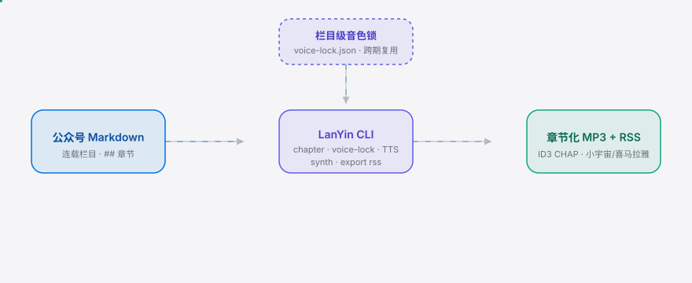
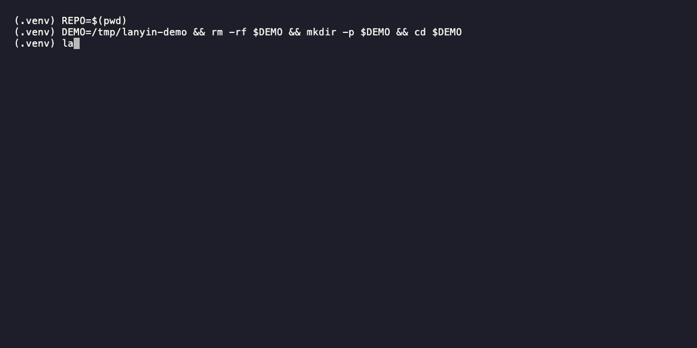

<div align="right"><sub><b>English</b>&nbsp;&nbsp;⇄&nbsp;&nbsp;<a href="./README.md">简体中文</a></sub></div>

<picture>
  <source media="(prefers-color-scheme: dark)" srcset="./assets/hero-dark.svg">
  <source media="(prefers-color-scheme: light)" srcset="./assets/hero-light.svg">
  
</picture>

<p align="center"><sub>LanYin is the voice-lock skill turning WeChat columns into subscribable audio for commercial creators.</sub></p>

<p align="center">
  <a href="./LICENSE"></a>
  <a href="https://github.com/SuperMarioYL/lanyin/releases"></a>
  <a href="https://github.com/SuperMarioYL/lanyin/actions/workflows/ci.yml"></a>
  
  
  
</p>

**Generic TTS drifts voice per episode, chapters are hand-stitched, exports are manual — LanYin locks the column voice in one command, ships chaptered MP3s, and exports 小宇宙/喜马拉雅-compliant RSS.**

<h2> Architecture</h2>

<picture>
  <source media="(prefers-color-scheme: dark)" srcset="./assets/atlas-dark.svg">
  <source media="(prefers-color-scheme: light)" srcset="./assets/atlas-light.svg">
  
</picture>

One Python process, one `.lanyin/` config dir. The MiniMax H3 call is the only network dependency; if the API is down, the build halts with a clear error — never silently falls back to a different voice (that would break the lock).

## Table of Contents

- [Why this exists](#why-this-exists)
- [Install](#install) · [Quickstart](#quickstart)
- [Usage](#usage)
- [Demo](#demo)
- [Configuration](#configuration)
- [Pricing](#pricing)
- [Roadmap](#roadmap)
- [License](#license) · [Share this](#share-this)

## Why this exists

A WeChat column author running a 20-part science column who wants a 小宇宙 podcast arm must hand-paste each episode through a generic TTS, re-synthesize per piece with a voice that drifts between episodes, hand-stitch chapter boundaries, and hand-format the export for 小宇宙/喜马拉雅. Episode 11 no longer audibly matches episode 3. Minimax H3, the omni-modal stereo base that u/Mobile-Pumpkin7944 surfaced on [r/LocalLLaMA](https://www.reddit.com/r/LocalLLaMA/comments/1ve1mvh/minimaxh3_now_on_huggingface/), owns none of the WeChat-column → audio-series workflow. LanYin is the Skill-style voice-lock layer — the audio analog of the reusable taste/lock pattern the [Shubhamsaboo/awesome-llm-apps](https://github.com/Shubhamsaboo/awesome-llm-apps) community crystallized — that turns H3 into a subscribable Chinese serial-audio asset.

## Install

```bash
pip install lanyin        # or: uv tool install lanyin
```

Requires Python ≥ 3.12. Voice cloning needs a MiniMax H3 API key (see [Configuration](#configuration)); `init` / `add` / `voice show` work offline.

## Quickstart

Cold clone to first visible result, three lines:

```bash
lanyin init sv-breakfast              # scaffold lanyin.toml
lanyin add examples/ep01.md           # ## headings become chapter marks
lanyin voice show                     # read the locked voice (m1)
```

<details><summary>sample output</summary>

```
╭─ episode registered ──────────────╮
│ source        ep01.md             │
│ chapters      3                   │
│ registry      .lanyin/episodes.json│
╰────────────────────────────────────╯
  ch01  Chapter 1 — Why lock the column voice
  ch02  Chapter 2 — Minimax H3 is the base, LanYin is the workflow
  ch03  Chapter 3 — One command to a subscribable series
```

</details>

Lock a MiniMax H3 voice (needs `MINIMAX_API_KEY`):

```bash
export MINIMAX_API_KEY=mm-xxxxxxxx
lanyin voice lock --sample ./voice.mp3 --name "signature-voice"   # writes .lanyin/voice-lock.json (m1)
```

## Usage

<h2> Usage</h2>

```bash
lanyin init <column-name> --platform xiaoyuzhou          # scaffold lanyin.toml (xiaoyuzhou | ximalaya)
lanyin voice lock --sample ./voice.mp3 --name "voice"    # clone+lock a MiniMax H3 voice (m1)
lanyin voice show                                        # print the locked column voice profile (m1)
lanyin add ./ep01.md                                     # register an episode; ## → chapters (pure)
lanyin build ./ep01.md                                   # synthesize chaptered MP3 in the locked voice (m2 · roadmap)
lanyin export rss --platform xiaoyuzhou                  # emit 小宇宙/喜马拉雅-compliant RSS (m3 · roadmap)
```

m1 is implemented: `voice lock` + `voice show` + the chapter parser + the MiniMax H3 client. m2 (synthesis + ID3 CHAP embed) and m3 (batch export) are on the roadmap — the CLI is wired and tells you honestly "not implemented in this milestone" when run.

Full examples live in `examples/`: `ep01.md` (a three-chapter sample column), `voice-lock.sample.json` (a locked-voice profile for offline demo).

## Demo

<h2> Demo</h2>



Script: `docs/demo.tape` (rendered to `assets/demo.gif` with [vhs](https://github.com/charmbracelet/vhs); CI refreshes it on manual dispatch via `.github/workflows/demo.yml`). The run above is the m1 happy path: `init` → seed a locked voice → `voice show` → `add` → the honest m2/m3 roadmap messages.

**Sample audio series** (the `assets.demo` artifact) — a real serialized WeChat column, 10 episodes all synthesized in ONE locked MiniMax H3 voice, blind-testable across episodes:

<details><summary>docs/demo/xiaoyuzhou-sample-rss.xml (小宇宙-compliant RSS, 10 episodes)</summary>

```xml
<rss version="2.0" xmlns:itunes="http://www.itunes.com/dtds/podcast-1.0.dtd">
  <channel>
    <title>sv-breakfast</title>
    <description>10 episodes all synthesized with the same locked MiniMax-H3 voice_id — blind-testable across episodes.</description>
    <itunes:author>signature-voice (LanYin locked)</itunes:author>
    <item>
      <title>Ep 1 — Why lock the column voice</title>
      <enclosure url="https://cdn.example.com/lanyin/guigu-zaocha/ep01.mp3" length="4823100" type="audio/mpeg"/>
      <itunes:duration>612</itunes:duration>
    </item>
    <!-- ... 9 more same-locked episodes ... -->
  </channel>
</rss>
```

</details>

The full 10-episode feed is at [`docs/demo/xiaoyuzhou-sample-rss.xml`](./docs/demo/xiaoyuzhou-sample-rss.xml) — the target output shape of m3's `lanyin export rss --platform xiaoyuzhou`.

## Configuration

`lanyin init` writes `lanyin.toml` (TOML, stdlib-readable, no extra deps); the voice lock and episode registry live under `.lanyin/` (local state, gitignored).

| Key | Type | Default | Meaning |
|---|---|---|---|
| `column.column_id` | str | slug of column name | Column identifier, written into the voice lock |
| `column.column_name` | str | — | Human-readable column name |
| `column.chapter_heading_level` | int | `2` | Which Markdown heading level marks a chapter (`##` = 2) |
| `column.platform_target` | str | `xiaoyuzhou` | Export target: `xiaoyuzhou` \| `ximalaya` |
| env `MINIMAX_API_KEY` | str | — | MiniMax H3 API key, required for `voice lock` |
| env `MINIMAX_GROUP_ID` | str | — | Optional, some MiniMax endpoints want group_id |

## Pricing

<h2> Pricing</h2>

LanYin is OSS CLI, free and self-hostable. The commercial path is a **hosted column-托管 tier** (post-m1):

- **Free CLI**: lock the voice, chaptered MP3s, local RSS export — this repo.
- **Column hosting ¥39/month per column** (single author): paste a new episode and the 小宇宙/喜马拉雅 RSS auto-rebuilds in the locked voice — you pay so you don't run the CLI every Tuesday.
- **Team ¥99/month** (≤5 columns, ≤3 seats): multi-column team workspace + premium licensed voice pack (beyond the free MiniMax H3 presets).

The voice-lock + chapter assets are the moat; the hosted tier just rents them. Smallest "credit card" demo: author pastes ep11 markdown into the hosted workspace → RSS auto-rebuilds in the locked voice → one-click push to 小宇宙. The free CLI proves the voice lock; the paid path proves "I don't want to run the CLI every Tuesday."

> After pushing, add topics: `gh repo edit --add-topic tts --add-topic podcast --add-topic minimax --add-topic voice-clone --add-topic wechat`

## Roadmap

<h2> Roadmap</h2>

- [x] **m1 column voice lock** — `voice lock` writes `.lanyin/voice-lock.json`; `voice show` prints the locked profile; the MiniMax H3 client + chapter parser are in place.
- [ ] **m2 chaptered synthesis** — `lanyin build ./ep01.md` synthesizes `dist/ep01.mp3` in the locked voice; ID3 `CHAP` frames from `##` headings; a second episode in the same lock audibly matches.
- [ ] **m3 series export** — `lanyin build` (no args, batch) + `lanyin export rss --platform xiaoyuzhou|ximalaya` emits platform-compliant RSS.
- [ ] **Future** — hosted column-托管 tier; voice marketplace; multi-column management; if 豆包/CosyVoice ship stable cross-session voice IDs + chapter markup + platform export, reassess (§8 falsifier).

## License

<h2> License</h2>

MIT — see [LICENSE](./LICENSE). File an issue or PR at [issues](https://github.com/SuperMarioYL/lanyin/issues).

## Share this

```
LanYin — the Skill that turns a serialized WeChat column into a voice-locked audio series. One voice_id locked per column, ## headings become ID3 chapters, one command exports 小宇宙/喜马拉雅 RSS. A blind 10-episode match is the moat. https://github.com/SuperMarioYL/lanyin
```

<p align="center"><sub><a href="./LICENSE">MIT</a> © 2026 SuperMarioYL</sub></p>
